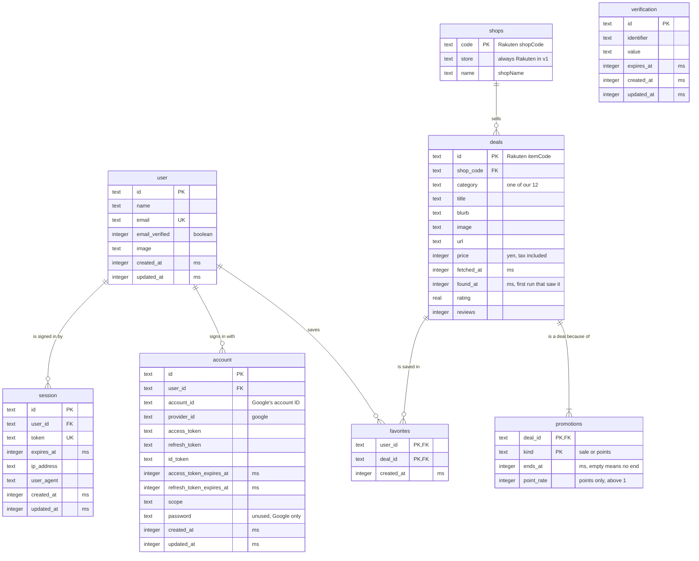

# Data model

The model agreed for SID-17. `worker/db/schema.ts` does not match it yet: it still holds the
prototype's `deals` table. Change this file in the same pull request as any schema change.

- A deal is a Rakuten listing in a sale with an end date, or with a point rate above 1
  (decision 7). Each reason is one row in `promotions`.
- A deal's end is not stored. It is the later end of its active promotions, and empty when points
  have no end.
- The collector deletes deals fetched more than 24 hours ago (decision 6). Their promotions and
  favorites go with them, then any shop left with no deals.
- Category and store are the fixed lists in `worker/db/taxonomy.ts`. The collector maps Rakuten
  genres to categories before writing, so genres are not stored.
- `user`, `session`, `account` and `verification` belong to Better Auth and are regenerated by
  `npm run auth:generate`.

The same diagram in Eraser: https://app.eraser.io/workspace/NTlsUT6qmOTKMqiZt7tD
